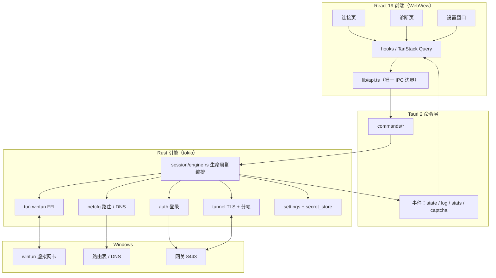
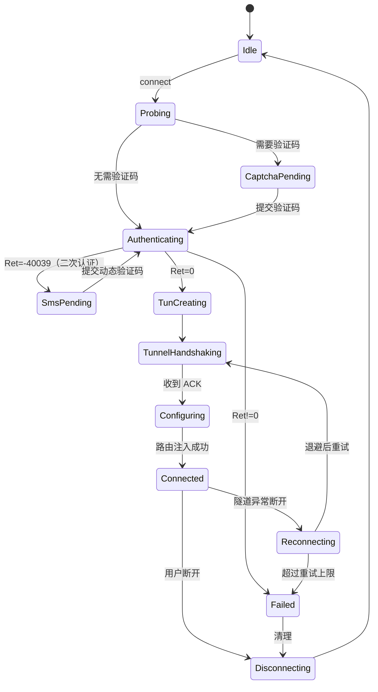
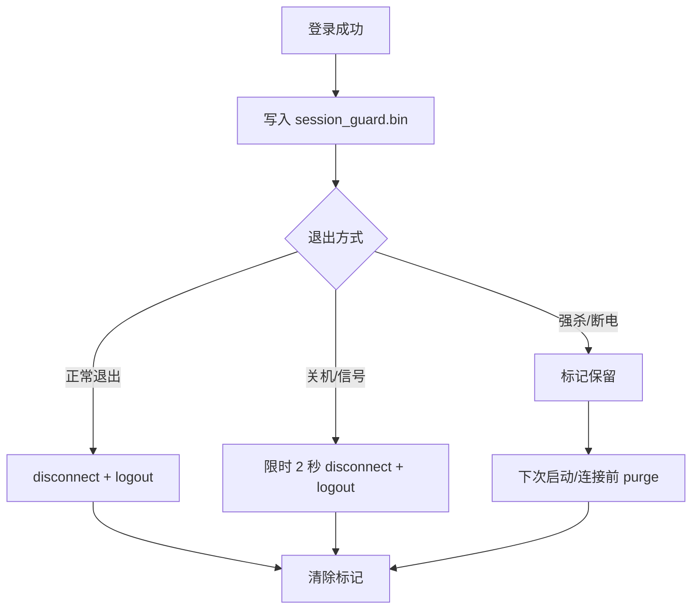

# TopSAP-Next 架构与实施规划

> 版本：v0.1.0 规划稿
> 目标：用 Tauri 2 + React 19 + Rust 重写天融信 NGVONE / TopSAP SSL VPN 客户端，替代原 Electron 实现。
> 协议依据：原项目 `topsap-client/docs/PROTOCOL.md`（真机实测确认）。

---

## 1. 背景

原客户端 TopSAP 3.6.4.16.64.1 是 Electron 界面 + 原生 C 引擎 + NDIS 驱动的组合。界面层存在卡死、崩溃、字段错配等问题，原生引擎本身工作正常。

已完成的逆向工作确认了完整协议链路：

- 登录：`auth_param` → `gid`（验证码）→ `user_pswd`，网关不校验 `HASH` 内容
- 二次认证：`user_pswd` 返回 `-40039` 时，`send_sms` 下发动态验证码，`sms` 接口携带验证码完成登录
- 隧道：独立 TLS 长连接 + 16 字节自定义帧头，`type=15` 载荷为原始 IPv4 报文
- 数据面：无额外加密（`cipher_type=0` 的 `ngvone` 网关）
- 网络模型：虚拟网卡 + 分流路由 + 网卡 DNS

原 `topsap-client`（Electron）已验证协议可行，但工程上存在：体积大、无类型约束、无测试、UI 与引擎耦合、异常退出残留路由。

本项目做**工程重写**，不是协议再逆向。

---

## 2. 目标与非目标

### 2.1 目标

| 编号 | 目标 | 验收方式 |
| --- | --- | --- |
| G1 | 协议行为与原实现等价 | 对真实网关登录成功、隧道握手完成、收到 DNS 回包 |
| G2 | 数据面端到端可用 | 连接后访问内网 Web 返回真实响应 |
| G3 | 断开无残留 | 路由、DNS、网卡全部回滚，重启后自检可用 |
| G4 | 界面稳定可预期 | 全部状态可达、错误有中文原因与下一步建议 |
| G5 | 可安装分发 | NSIS 安装包，管理员权限，覆盖安装保留配置 |
| G6 | 可维护 | Rust 单测覆盖协议编解码/解析/掩码；前端纯函数测试 |

### 2.2 支持平台

| 平台 | 状态 | 说明 |
| --- | --- | --- |
| Windows 11 / 10 | 主路径，已验证 | 使用 PowerShell 3.0+ 的 NetTCPIP 模块作为配置回退 |
| Windows 7 SP1 | 兼容路径 | 运行时检测版本 6.1，全部走 `netsh` / `route`；需 WebView2 109 与 VC++ 运行库 |
| macOS Intel / Apple 芯片 | 已实现，待真机验证 | 系统 utun + `route` / `ifconfig`，需要 root；应用未签名与公证 |
| Linux amd64 / arm64 | 已实现，待真机验证 | `/dev/net/tun` + `ip route`，需要 root |

### 2.3 非目标

- 国密网关（`sm2plusvone`）——仅支持 `ngvone` + `cipher_type=0`
- SPA 单包授权（标准网关不启用）
- 与原厂服务/驱动共存——必须完全替代，不能同时登录同一账号

---

## 3. 技术选型

| 层 | 选型 | 理由 |
| --- | --- | --- |
| 外壳 | Tauri 2 | 体积约 10–15 MB，系统 WebView，Rust 后端 |
| 后端 | Rust 2021 + tokio | 异步流、FFI、系统调用都有一等支持 |
| TLS | rustls 0.23（ring provider）+ tokio-rustls | 不依赖 OpenSSL；可自定义证书校验 |
| HTTP | reqwest（rustls-tls，禁用默认特性） | 登录接口 |
| FFI | libloading + windows crate | 动态加载 wintun.dll，取 kernel32 等待函数 |
| 前端 | React 19 + TypeScript 5/6 + Vite | 与技能规范一致 |
| 样式 | Tailwind CSS 4（@tailwindcss/vite） | 主题变量、无运行时 CSS |
| 数据层 | TanStack Query 5 | 命令结果缓存与失效 |
| 图标 | lucide-react | 规范要求 |
| 通知 | sonner | 规范要求 |
| 测试 | vitest（前端）/ cargo test（后端） | 规范要求 |
| 凭据 | keyring 3 + AES-256-GCM 回退 | 规范要求 |

### 3.1 rustls provider 纪律

依赖图必须只出现一个 provider。锁定：

```toml
rustls = { version = "0.23", default-features = false, features = ["ring", "std", "logging", "tls12"] }
tokio-rustls = { version = "0.26", default-features = false, features = ["ring", "tls12"] }
reqwest = { version = "0.12", default-features = false, features = ["rustls-tls"] }
```

启动时显式安装：

```rust
rustls::crypto::ring::default_provider().install_default().expect("安装 rustls provider 失败");
```

提交前用 `cargo tree -i aws-lc-rs` 确认没有第二个 provider。

### 3.2 不发 SNI 的实现

官方客户端不发送 SNI。rustls 的 `ServerName` 若为 IP 地址，按 RFC 6066 不会写入 SNI 扩展。因此隧道连接使用**网关解析后的 IPv4 地址**构造 `ServerName::IpAddress`，既满足 API 要求又保持行为一致。

---

## 4. 系统架构



### 4.1 数据流

```
系统网络栈 ──▶ Wintun 网卡 ──▶ tun.read_loop ──▶ tunnel.send_data ──▶ TLS ──▶ 网关
系统网络栈 ◀── Wintun 网卡 ◀── tunnel.recv_data ◀── 拆帧 ◀── TLS ◀── 网关
```

### 4.2 连接状态机



---

## 5. 目录结构

```
TopSAP-Next/
├── src/                         # React 前端
│   ├── main.tsx
│   ├── App.tsx
│   ├── index.css                # Tailwind 4 + 主题变量
│   ├── types/engine.ts          # 与 Rust DTO 一一对应
│   ├── lib/
│   │   ├── api.ts               # 唯一 IPC 边界
│   │   ├── format.ts            # 纯函数（字节/时长/IP 校验）
│   │   ├── format.test.ts
│   │   └── query.ts             # QueryClient
│   ├── hooks/
│   │   ├── useEngineEvents.ts   # 事件订阅
│   │   └── useConnection.ts     # 连接 mutation
│   ├── pages/
│   │   ├── ConnectPage.tsx
│   │   ├── DiagnosticsPage.tsx
│   │   └── SettingsPage.tsx
│   └── components/
│       ├── ui.tsx               # Button/Input/Badge/StatusDot/Modal...
│       ├── AppShell.tsx
│       ├── StatusHero.tsx
│       ├── CaptchaDialog.tsx
│       ├── StatsGrid.tsx
│       ├── LogPanel.tsx
│       └── SelfTestPanel.tsx
├── src-tauri/
│   ├── Cargo.toml
│   ├── build.rs                 # 管理员 manifest
│   ├── tauri.conf.json
│   ├── capabilities/default.json
│   ├── resources/wintun.dll
│   ├── icons/
│   └── src/
│       ├── main.rs
│       ├── lib.rs               # 只做装配
│       ├── platform.rs          # 运行环境探测（Windows 7 兼容分支）
│       ├── dto.rs               # 跨领域 DTO
│       ├── settings.rs
│       ├── profiles.rs          # 连接配置存储与导入导出
│       ├── proxy_bypass.rs      # 三平台系统代理绕过列表
│       ├── secret_store.rs
│       ├── helper.rs            # macOS root helper：TUN 创建与白名单命令
│       ├── privileged.rs        # macOS helper 客户端与 LaunchDaemon 安装
│       ├── session_guard.rs     # 异常退出会话标记与下次启动补注销
│       ├── shutdown.rs          # 系统关机/终止信号下的限时断开
│       ├── auth/{mod,client,error,parser}.rs
│       ├── protocol/{mod,frame,consts}.rs
│       ├── tunnel/{mod,client,verifier}.rs
│       ├── tun/{mod,ffi,device,selftest}.rs
│       ├── netcfg/{mod,routes,hosts,dns,shell}.rs
│       ├── session/{mod,engine,state,events}.rs
│       └── commands/{mod,app,conn,diag,settings}.rs
├── docs/
│   ├── ARCHITECTURE.md
│   └── PROTOCOL.md
├── scripts/
├── package.json
├── vite.config.ts
├── tsconfig*.json
├── README.md
└── CHANGELOG.md
```

---

## 6. 协议规格（实施依据）

### 6.1 登录

| 步骤 | 请求 | 关键点 |
| --- | --- | --- |
| 能力探测 | `POST /vone/login/auth_param` | 无需认证，返回伪 JSON（键名无引号） |
| 取验证码 | `GET /vone/login/gid` | 返回 PNG + `Set-Cookie: cgid` |
| 提交登录 | `POST /vone/login/user_pswd` | `U/P` 明文，`HASH` 64 个 0，`S_CODE` 随机 |
| 发送动态验证码 | `POST /vone/login/send_sms` | 仅 `-40039` 二次认证时调用；`U` 明文、`P` 为空、`Gid`；`SMS_TIME` 取 `topsecsveee` Cookie |
| 提交动态验证码 | `POST /vone/login/user_pswd` | `U/SMS/SMS_TIME=0/HASH/S_CODE`；复用 `-40039` 挑战 Cookie，`HASH/S_CODE` 与密码请求一致，不发送 `sv_un` |
| 密码到期/首次登录 | `-40022/-40023/-40024/-40199` | 弹出无会话改密窗口，成功后自动重连；`-40081` 的 `ErrMsg` 明确提到密码到期/首次登录时同样转入该窗口；忘记密码重置后记录 7 天标记并先尝试刷新有效期 |
| 登录到期提醒 | `user_param.pwd_remind/account_end` | 连接成功后分别 toast 密码剩余天数与账号剩余天数，0 不提示 |
| 找回密码 | `POST /vone/find_pswd` | 第一步 `Gid/S_Gid` 同一验证码；`-40230` 后第二步 `SMS` + 明文新密码 |
| 修改密码 | `POST /vone/chg_pwd` | 已登录会话；请求体仅明文 `P1/P2`，Cookie 的 `sv_un` 为明文账号并带 `seccheck=0` 与会话 ID；成功后按原客户端注销会话并清除本地记住的旧密码 |
| 注销 | `POST /vone/login/logout` | Cookie 带 session_id |

公共头：`User-Agent: VONE-AUTH,WINDOWS,NULL,TOPCLINET,NULL`。

验证码策略取 `auth_param.gid`（`on`/`auto`/`off`）与 `login_check_verify`；`auto` 模式在 `login_err_num >= 3` 后要求图形验证码，失败次数按账号跨连接保留，与原客户端 Cookie 行为一致。

表单编码陷阱：`+` 必须编码为 `%2B`，空格编码为 `+`。

错误码：`0` 成功、`-7` 格式错、`-40018` 验证码错、`-40039` 需要动态验证码、`-40045` 动态验证码错误或过期、`-40077` 单点冲突、`-40081` 账号密码错、`-40050` 锁定、`-40142` 重置密码过于频繁。

### 6.2 帧格式

```
+0..3    保留（0）
+4..7    消息类型（大端）：1=登录 2=确认 7=通知 15=IPv4 数据
+8..11   载荷长度（大端）
+12..15  方向：1=上行 0=下行
```

登录帧载荷固定 328 字节：偏移 0 写 `0x00000004`，偏移 72 写 session_id（ASCII），其余补零。

隧道握手序列：

```
TLS 建连（不校验证书、不发 SNI）
→ "CONNECT 127.0.0.1:4430 HTTP/1.1\r\nhost:127.0.0.1\r\n
   User-Agent: VONE-NA,WINDOWS,NULL,TOPCLINET,NULL\r\n
   Proxy-Connection: Keep-Alive\r\n\r\n"
→ 登录帧（type=1）
← 确认帧（type=2）
→ 通知帧（type=7，8 字节零）
↔ 数据帧（type=15，原始 IPv4）
```

流式拆帧必须处理粘包/半包；单帧上限 65551 字节。

### 6.3 网络配置

- 网卡：Wintun，名称 `TopSAP`，固定 GUID，MTU 1400
- 地址：`net_param.vip_v4` / `vip_mask`
- 路由：按 ACL 目标网段与资源 `ip/mask` 并集生成；ACL 目标优先非零 `d_ip_v4`，否则取 `d_ip_v6`；`route_list` 不使用；网关 IP 必须加旁路路由
- 内网域名：解析 `dns_info.dns_list` 后仅保留在会话数据中，不修改系统 hosts（与原客户端一致）；`hosts` 模块保留用于清理旧版本残留
- DNS：网卡 DNS 设 `dns1_v4`，不劫持全局

---

## 7. 后端模块设计

### 7.1 模块职责

| 模块 | 职责 | 关键类型 |
| --- | --- | --- |
| `auth` | HTTP 登录三步骤、伪 JSON 解析、错误码映射 | `AuthClient`, `LoginConfig`, `AuthError` |
| `protocol` | 帧编解码、流式拆帧、常量 | `Frame`, `FrameEncoder`, `FrameParser` |
| `tunnel` | TLS 长连接、握手状态机、上下行计数 | `Tunnel`, `TunnelEvent`, `NoVerifyVerifier` |
| `tun` | wintun FFI 绑定、读循环、写包、自检 | `WintunApi`, `TunDevice`, `SelfTestReport` |
| `netcfg` | 网卡地址、路由注入/回读、DNS、旧版 hosts 残留清理 | `NetConfig`, `RouteEntry`, `CleanupLedger` |
| `session` | 生命周期编排、事件广播、自动重连 | `Engine`, `EngineState`, `EngineEvent` |
| `platform` | 运行环境探测，区分 Windows 7 与较新系统 | `is_windows7()` |
| `settings` | 应用设置读写与校验 | `AppSettings` |
| `proxy_bypass` | Windows / macOS / Linux 系统代理绕过列表同步 | `ProxyBypassStatus` |
| `secret_store` | keyring 优先 + AES-GCM 回退 | `SecretStore` |
| `helper` | macOS root LaunchDaemon：创建 utun、执行 ifconfig/route 白名单命令 | `helper::run()` |
| `privileged` | macOS helper 客户端、LaunchDaemon 安装与版本探活 | `ensure_helper()`, `create_tun()`, `run()` |
| `session_guard` | 异常退出会话标记、启动/连接前补注销 | `PendingSession`, `purge()` |
| `shutdown` | Windows `WM_ENDSESSION`、Unix 终止信号下的限时断开 | `quick_disconnect_blocking` |

### 7.2 错误约定

```rust
pub type CmdResult<T> = Result<T, String>;
```

- 面向用户的错误消息：中文、含原值、给下一步方向
- 内部错误用 `thiserror` 枚举，边界处 `map_err(to_user_message)`
- 禁止静默吞错；确需忽略时写注释说明

### 7.3 异步纪律

- 引擎长驻任务持有 `CancellationToken`
- `tokio::select!` 同时监听取消与数据源
- 读循环退出前归还句柄并置位状态
- 断开路径必须幂等：重复调用不报错、不重复删路由

### 7.4 关键实现细节

**Wintun FFI**

```rust
type WintunCreateAdapter = unsafe extern "system" fn(*const u16, *const u16, *const GUID) -> *mut c_void;
```

- `libloading::Library` 加载 `resources/wintun.dll`，`Library` 必须活到设备关闭
- 逐个解析符号，缺失时报告具体符号名（原 koffi 教训）
- 等待用 `kernel32!WaitForSingleObject`（`windows` crate），错误码用 `std::io::Error::last_os_error()`
- 读循环：`WaitForSingleObject(event, 0)` 非阻塞轮询 + 1ms 让出，或改为 `INFINITE` + 取消事件；采用前者保持简单

**TLS 校验器**

- 实现 `rustls::client::danger::ServerCertVerifier`
- `verify_server_cert` 返回 `ServerCertVerified::assertion()`
- 签名校验委托 `rustls::crypto::verify_tls12_signature` / `verify_tls13_signature`
- `supported_verify_schemes` 返回 ring provider 的方案列表
- 该行为与原客户端一致，README 与 UI 必须显著提示风险

**证书与 SNI**

- `ServerName::IpAddress` 指向网关解析后的 IP
- `Host` 头仍使用用户填写的域名（HTTP 层）

**路由回读**

- `route ADD` 后执行 `route print -4` 解析活动路由段，确认 `dest|mask` 存在
- 失败回退 `New-NetRoute`，再失败则计入失败数
- 全部失败直接报错，禁止"假连接"

**清理账本**

- `CleanupLedger` 记录每条注入的路由与 DNS 改动
- 断开时逆序撤销
- 启动时只检测旧版本 hosts 标记段；TUN 网卡与路由随进程句柄关闭或系统重启回收

### 7.5 异常退出补偿

正常退出、系统关机与终止信号的处理链路：

| 场景 | 入口 | 行为 |
| --- | --- | --- |
| 托盘退出 / 最后窗口关闭 | `RunEvent::ExitRequested` | 阻止退出，等待 `disconnect()` 完成后再退出 |
| Windows 关机/注销 | 主窗口子类过程的 `WM_ENDSESSION` | 抢在 Tao `process::exit` 前限时断开 2 秒 |
| Linux/macOS 终止信号 | `SIGTERM` / `SIGINT` | 限时断开后退出 |
| macOS AppKit 终止 | `RunEvent::Exit` | 最后一道限时断开兜底 |
| 强杀 / 崩溃 / 断电 | 无进程内入口 | 登录后写入加密会话标记，下次启动/连接前补注销 |



标记只保存网关、端口、`session_id` 与时间，使用机器绑定 AES-256-GCM 加密，Unix 下权限 0600；超过 24 小时不再重试。

### 7.6 已登录踢出

登录返回 `-40077` 时，`AuthClient::kick_user` 按原客户端状态机执行：

1. 重新 `POST /vone/login/auth_param`，刷新 Cookie；
2. 设置 `sv_un=<账号 Base64>`；
3. `POST /vone/login/user_pswd_r`，表单为 `U=<账号 Base64>&HASH=<原 HASH>&S_CODE=<原 S_CODE>`；
4. `Ret` 优先取响应体，缺失时回退 `X-sv-ret`；成功则 `normalize_login` 返回新的 `session_id`。

密码登录与动态验证码登录两条路径都会在 `-40077` 时尝试一次踢出；踢出后若网关要求动态验证码，继续复用现有短信流程。该逻辑不依赖本地会话标记，因此官方客户端异常退出、当前客户端没有标记时同样生效。

### 7.7 macOS 特权 helper

官方 pkg 的 `PackageInfo` 声明 `auth="root"`，`PostInstall` 把 `com.topsec.vpn.TopServ.plist` 安装到 `/Library/LaunchDaemons` 并用 `sudo launchctl load -w` 加载 `LocalTopserv.app`（`LSUIElement`，以 root 运行），GUI 本身仍以用户身份运行。

本项目采用同样的「用户态 GUI + root helper」结构：

- 首次启动时 `privileged::ensure_helper()` 通过系统授权框把当前可执行文件复制到
  `/Library/Application Support/TopSAP-Next/topsap-helper`，安装
  `/Library/LaunchDaemons/com.topsap.next.helper.plist` 并启动；
- helper 以 `--helper --uid <uid>` 运行，只接受该 uid 的本地 Unix socket 连接；
- helper 只提供两类能力：创建 utun 并通过 `SCM_RIGHTS` 传回 fd；执行
  `/sbin/ifconfig` 与 `/sbin/route` 白名单命令；
- `tun/unix.rs` 在 macOS 优先使用 helper 创建 utun，`netcfg/shell.rs` 把
  ifconfig/route 请求转发给 helper；`is_elevated()` 以 helper 可用为准；
- helper 不可用且进程不是 root 时，自检与连接明确提示 helper 未运行；
- 本地 root 运行（`sudo open`）仍保留为调试回退。

helper 安装使用 root LaunchDaemon 而非 `SMJobBless`，因此不要求 Apple 开发者签名；代价是首次安装需要一次管理员授权，且多用户机器上 helper 按首次安装的 uid 服务。

---

## 8. 前端设计

### 8.1 布局

```
┌──────────────────────────────────────────────────┐
│ Sidebar        │ 内容区                           │
│ 品牌 + 状态徽标 │ ┌─────────────────────────────┐ │
│ 连接            │ │ 状态 Hero（状态/虚拟IP/时长） │ │
│ 诊断            │ ├─────────────────────────────┤ │
│ 设置            │ │ 连接表单 / 统计 / 日志        │ │
│                │ └─────────────────────────────┘ │
└──────────────────────────────────────────────────┘
```

窗口 1080×720，最小 960×640。

### 8.2 主题

- 深色为默认，提供浅色切换，跟随系统 `prefers-color-scheme`
- 所有颜色走 CSS 变量（`--bg`, `--surface`, `--border`, `--text`, `--accent`, `--ok`, `--warn`, `--danger`）
- Tailwind 4 `@theme` 映射变量，禁止硬编码 hex

### 8.3 状态与交互

- 连接按钮五态：默认 / 处理中（spinner）/ 已连接（变断开）/ 禁用 / 错误
- 验证码：Modal 展示 PNG，支持点击刷新、回车提交、120 秒超时
- 动态验证码：`sms_pending` 阶段弹出 OTP 弹窗，支持回车提交、重新发送倒计时（网关 `sms_valid_time`，上限 600 秒）、3 次输错重试，超时或取消失败时自动收起
- 日志：虚拟滚动或 500 行上限，自动滚底，支持清空与导出
- 统计：上行/下行/收发包/时长，1 秒刷新
- 所有异步操作有 toast：成功简要，失败给原因与下一步
- 设置以窗口形式打开：左侧子菜单（通用 / 连接管理 / 代理绕过 / 外观 / 关于），右侧内容区；所有开关、主题、语言与连接配置更改即时生效，无需保存按钮
- 代理绕过：设置窗口维护域名/泛域名/IP 列表，默认 `*.sunline.cn` 与 `*.sunline-i.com`；Windows 写 `ProxyOverride`，macOS 写 `networksetup` 逐网络服务列表，Linux 写 GNOME `gsettings ignore-hosts`；启动时重新应用，关闭只移除本应用写入的条目
- 中英文切换：`lib/i18n.tsx` 以中文原文为 key、英文缺失回退中文，语言偏好写入 localStorage
- 连接配置选中后隐藏网关地址与端口；多线路优选可勾选「自动选择线路」，未勾选时连接前弹出按延迟排序的线路选择
- 下拉框使用自绘 `Select` 组件，展开时箭头旋转，菜单跟随主题样式
- 连接成功后显示当前账号与「修改密码」入口，原密码、新密码、确认密码三项校验后提交；改密成功后自动注销并在重新登录时提示「登录密码已自动填入」
- 所有密码框使用 `PasswordInput`：隐藏 WebView 原生眼睛，右侧固定显示/隐藏按钮
- 连接成功但无资源地址（`resources` 为空或 `routes=0`）时提示「用户未拥有任何资源地址，请联系管理员」并自动断开
- 所有 toast 使用 Sonner `richColors` 原生样式；密码类成功提示经 `toastPasswordSuccess` 统一走 success 分支
- 图形验证码登录复用选路探测的 Cookie；`-40135/-40018` 自动刷新验证码并最多重试 3 轮
- 改密前预检新旧密码，后端同时把 `-40037/-40129` 映射为「新密码不能与旧密码一致」
- 找回密码第一步除验证码错误外自动刷新验证码；第二步 `-40230` 按成功处理并关闭弹窗
- 连接后信息卡片：资源列表、基本信息、60 秒流量曲线、登录信息；`SessionSummary` 从 `user_param` 与 `res_list` 提取网关版本、登录历史与资源分组

### 8.4 IPC 边界

`lib/api.ts` 唯一出现 `invoke` 的文件：

```ts
export const api = {
  info: () => invoke<AppInfo>("app_info"),
  login: (form: LoginForm) => invoke<LoginResult>("login", { form }),
  submitCaptcha: (code: string) => invoke<void>("submit_captcha", { code }),
  connect: () => invoke<void>("connect"),
  disconnect: () => invoke<void>("disconnect"),
  snapshot: () => invoke<EngineSnapshot>("engine_snapshot"),
  selfTest: () => invoke<SelfTestReport>("run_self_test"),
  loadSettings: () => invoke<AppSettings>("load_settings"),
  saveSettings: (s: AppSettings) => invoke<void>("save_settings", { settings: s }),
  openLogDir: () => invoke<void>("open_log_dir"),
};
```

事件（`listen`）：`engine://state`、`engine://log`、`engine://stats`、`engine://captcha`。

---

## 9. 安全设计

| 项 | 措施 |
| --- | --- |
| 密码落盘 | keyring（Windows 凭据管理器）；失败回退 AES-256-GCM + 机器标识派生密钥 |
| 会话标记 | 仅保存网关、端口与 `session_id`；AES-256-GCM + 机器绑定密钥，Unix 权限 0600，超过 24 小时不再重试 |
| 存储位置 | Windows 便携布局：`<exe>/config`、`<exe>/data/logs`、`<exe>/webview`；macOS/Linux 使用系统标准目录 |
| 日志脱敏 | 密码、验证码、session_id、SPA key 一律不进日志 |
| CSP | 生产禁用 `unsafe-eval`，仅允许自身资源与 `data:` 图片 |
| IPC | 命令白名单，无通用文件/进程执行命令 |
| 提权 | 进程级 `requireAdministrator`，不做运行时 UAC 提升 |
| 证书 | 不校验（协议要求），UI 常驻风险提示，README 显著说明 |

---

## 10. 实施阶段

| 阶段 | 内容 | 交付验证 |
| --- | --- | --- |
| P0 | 规划、目录、工程配置 | `npm run build` 空壳可跑 |
| P1 | Rust `protocol` / `auth` / `tunnel` + 单测 | `cargo test`；CLI 探针登录成功 |
| P2 | Rust `tun` / `netcfg` / 自检 | `cargo test`；自检 8/8 |
| P3 | `session` 引擎 + Tauri 命令 | `cargo clippy`；命令可调用 |
| P4 | React 前端全部页面 | `tsc --noEmit`、`vitest run`、界面截图 |
| P5 | 托盘/单实例/设置/凭据 | 关窗最小化托盘、二次启动聚焦 |
| P6 | NSIS 打包 + 提权 + 真机连接 | 安装包可装、真实网关登录并访问内网 |
| P7 | 文档、CHANGELOG、Obsidian 归档 | 文档齐备 |

---

## 11. 验证口径

```bash
# 前端
npx tsc --noEmit
npm test
npm run build

# 后端（src-tauri/）
cargo fmt --check
cargo clippy --all-targets -- -D warnings
cargo test --lib
```

真机验证清单：

1. 启动即提权，界面正常渲染
2. 登录 → 验证码 → 成功，显示虚拟 IP 与路由数
3. 连接后 `ping`/`curl` 内网地址有真实响应
4. 断开后路由表回到基线，网卡断开
5. 强杀进程后重新启动，日志出现「已补注销」，本地无残留网卡/路由
6. 系统关机/注销时日志出现限时断开记录，重启后可正常登录
7. 二次启动不产生第二个实例

---

## 12. 风险与边界

| 风险 | 影响 | 应对 |
| --- | --- | --- |
| rustls 0.23 API 与文档差异 | TLS 建连失败 | 先用最小 demo 打通，再接入隧道 |
| wintun FFI 类型/对齐错误 | 崩溃或建卡失败 | 严格按 wintun.h 声明；自检覆盖 |
| NSIS 提权 manifest 未生效 | 无法建网卡 | 构建后检查嵌入 manifest |
| 网关证书/协议变更 | 连接失败 | 错误分类明确，保留原始响应片段 |
| 企业安全软件拦截 | 无法加载 DLL | 提示用户加白，记录具体错误码 |
| 强杀/断电 | 网关注销缺失 | 会话标记 + 下次启动补注销；本地网卡与路由由系统回收 |

---

## 13. 与旧实现的行为对照

| 方面 | 旧 Electron 版 | TopSAP-Next |
| --- | --- | --- |
| 登录 | Node https | reqwest + rustls，同一路径与字段 |
| 隧道 | Node tls | tokio-rustls，同一帧格式 |
| 网卡 | koffi 绑 wintun | libloading 绑 wintun，同一 API |
| 路由 | netsh/route + 回读 | 同策略，Rust 实现 |
| 配置存储 | safeStorage | keyring + AES-GCM 回退 |
| 异常退出 | 残留 28 条路由 | 会话标记 + 下次启动补注销；本地网卡/路由随句柄回收 |
| 自动重连 | 无 | 指数退避，最多 5 次 |
| 托盘 | 无 | 有 |
